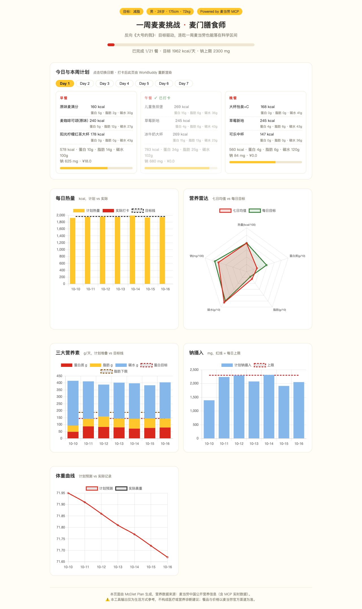

# McDiet Plan 麦门膳食师 🍔

**[EN] The Reverse "Super Size Me" — eat McDonald's for a whole week and still hit your fitness goals.**

> 输入身体数据和目标，一周三餐全吃麦当劳，也能科学落在营养区间。
> 反向《大号的我》：2004 年纪录片证明了"乱吃 30 天会垮"，这个项目用麦当劳自己的营养数据证明"会算就能行"。


*↑ 真实 MCP 营养数据求解生成的 7 天计划页（Day 1 午餐已打卡，晚餐自动重排进剩余预算）*

**麦门膳食师**是一个基于**麦当劳中国 MCP** 开发的参赛 Skill（麦当劳程序员创意开发大赛）。它不是"帮您点餐"，而是一个**7 天饮食教练**：

- 🎯 **目标驱动**：性别/年龄/身高/体重/活动量 → Mifflin-St Jeor 公式算出每日热量与蛋白质目标
- 🧮 **多约束求解**：在 40+ 款麦当劳单品中求解 7 天 × 3 餐组合（贪心 + 局部搜索，纯 Python 标准库零依赖），约束含热量带宽、蛋白质缺口、**钠上限提醒**（麦当劳餐最大的坑）、忌口、多样性（同单品全周 ≤3 次）
- 📅 **7 天打卡闭环**：每天说一句"中午吃了麦辣鸡腿堡套餐"，自动匹配营养、扣减当日热量预算、**重排剩余餐次**
- 📊 **可视化网页**：周计划、每日热量计划 vs 实际、营养雷达图、钠摄入柱状图、体重预测曲线，单文件 HTML 可直接分享

## 为什么"一周只吃麦麦"是个严肃问题？

麦当劳全品类公开营养数据 + 严格的目标函数 = 一场真实的约束优化实验。我们的求解器会发现：

- 0 卡饮料 + 无酱板烧鸡腿堡 + 玉米杯/色拉 能把一整天控制在目标区间
- 但**钠很难压进 2300 mg** —— 求解器会把钠超标如实标红提醒，而不是假装没问题

这正是本项目的态度：不吹"麦麦减肥法"，只做透明的营养计算。

## 快速开始

```bash
# 1. 生成计划（示例档案：28岁男性 175cm/72kg 轻活动 减脂）
python -m solver.cli plan --demo

# 2. 渲染可视化网页
python -m solver.cli render   # → plan.html，浏览器直接打开

# 3. 每日打卡（自动扣减预算并重排剩余餐次）
python -m solver.cli checkin --date 2026-10-12 --slot lunch --codes B03 S01 D01 --weight 71.8
python -m solver.cli render
```

运行时零第三方依赖（Python 3.10+）；测试：`pip install pytest && pytest`。

在 WorkBuddy 中使用：将本仓库作为 Skill 安装（见 `SKILL.md`），直接说"我要开启一周麦麦挑战"。

## 示例

见 [`examples/plan.html`](examples/plan.html)（含打卡重排效果的完整示例数据）。

## MCP 集成

见 [MCP_INTEGRATION.md](MCP_INTEGRATION.md)。核心数据源为 `list-nutrition-foods`（麦当劳官方营养数据），所有数据缓存优先，规避限流。

## 免责声明

本项目为参赛者独立开发，非麦当劳官方产品。所有输出仅为生活方式参考，**不构成医疗或营养诊断建议**；如有健康问题请咨询专业医生。餐品、价格与营养数据以麦当劳官方渠道为准。

## License

MIT（见 [LICENSE](LICENSE)）
